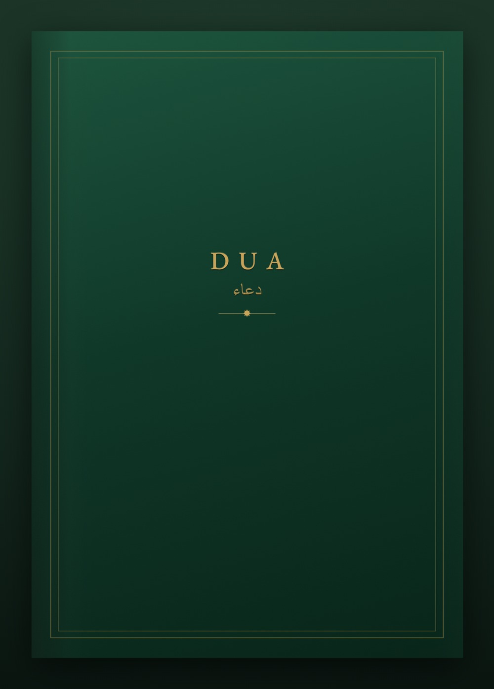
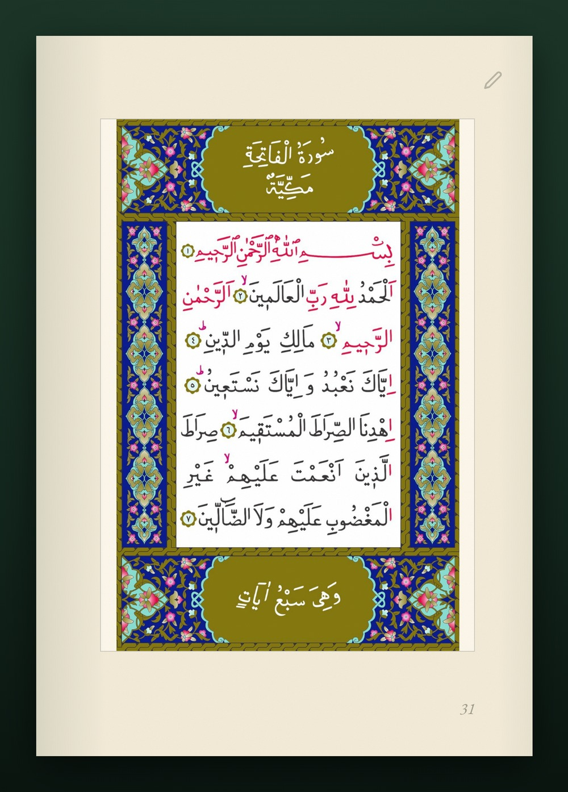

# Dua

A book of daily duʿās: deep-emerald cover, turning leaves, cream paper,
gold rules, no toolbars, no labels — the book is the interface.

  
  &nbsp;
  

  The book closed, and folio 31 — a picture lives on its own page,
  inside the same database as the words.

## First-time setup

Requires Python 3.11+ and (for the QA harness only) Node.js with a headless
Chrome available on `PATH`.

    python -m venv .venv
    .venv\Scripts\activate        # Windows   (Unix: source .venv/bin/activate)
    pip install -r requirements.txt
    python main.py

The app opens your browser at **http://127.0.0.1:8644**. The whole state of
the app is one SQLite file — `data/dua.db` — which ships with this repository:
the entries, and the pictures they name, are inside that one file. Point
`DUA_DB` at another file to start an empty book.

## INVARIANT — the entries are the author's words

The text in `data/dua.db` is the author's handwritten devotional material,
verbatim. No layer of this application may rewrite, reformat, "improve", or
reflow it — and contributors must not either. Treat the database like source
comments in a holy book: read it freely, change it only through the app.
(The duʿā text, the photographs in its `media` table, and the screenshots are
personal writings shared for completeness of the project; the code is what this
repository offers for use.)

## Using it

- Click the cover (or Enter) to open the book.
- Read: click a page's outer half, or → / Space / ←.
- Write: open **Index** and press the **+**, click the **+** on the blank
  last page, or press n. The newest entry always sits at the very end of the
  book. **Enter** creates a blank-line gap; **Shift+Enter** breaks the line
  without one; Backspace at a line's start joins it to the previous one.
- Edit: double-click an entry, or hover and click the margin pencil. Editing
  stays on the page you opened: tap a half of the screen to turn pages while
  editing, and text you type that spills past a page bottom flows onto the
  next page live — keep writing across pages without saving first.
- The icons that appear while editing: ✓ save · ✕ cancel · trash deletes
  (click it twice — first click arms it).
- Close: Esc or Home, or click the desk beside the book.

## Pictures

A page can hold a picture — a photo of a page from a book, a note, a wall.
Add the file to a running app, then give the entry a paragraph that is *only*
the name it was stored under:

    python -m dua.media_add 01-IMG_1578.jpg --url http://127.0.0.1:8644

    And I write this so I remember where I was:

    media/01-IMG_1578.jpg

    O Allah, keep it with me.

The bytes go into a `media` table **inside `data/dua.db`**, beside the entries:
no picture folder to keep in step with the book, so that one file is the whole
book — what you back up, and what you ship to another machine. `media_add`
posts over HTTP instead of writing the database itself, like everything else
that touches the book; add `--url` once per machine and it stays the only way in.

The line is the whole reference: it is stored as plain text, so the entry still
names its picture in a database backup or an `/api/export` JSON even if the
picture is gone (then the line simply shows itself instead of a broken image).
Pictures are laid out as blocks — they never split across a page — and they keep
their own aspect ratio. To remove one: click it (it goes red) and press
Backspace, or Backspace twice at the edge of the text beside it. Either way only
the line leaves the entry; the stored picture is untouched, and dropping a
picture for real is its own deliberate call (`DELETE /api/media/<name>`).

The browser is what decodes the picture, so a name must end in a type it
decodes — `.jpg`, `.jpeg`, `.png`, `.webp`, `.gif`; the API refuses anything
else, and the extension decides the content type it is served with. An iPhone
`.heic` photo shows nothing until it is converted; a straight re-encode at full
size is enough (no cropping, no resizing — the layout scales it to the column).

There is deliberately no alt text or caption field: the words in a picture
belong to the picture. If a picture needs a sentence of its own, type the
sentence as a paragraph next to it.

## Development

    python -m pytest tests -q      # API + media-store workflow tests
    node qa/workflow.mjs           # end-to-end browser workflow + screenshots
                                   # (spawns its own local server + temp DB)

Env knobs: `DUA_PORT` (default 8644), `DUA_HOST` (default 127.0.0.1),
`DUA_DB` (default `data/dua.db`).

See `docs/ARCHITECTURE.md` and `docs/WORKFLOW.md` for the design contract:
one-page-at-a-time pagination, phone-first layout, the editing model, and
the verbatim-body rule the store enforces.
